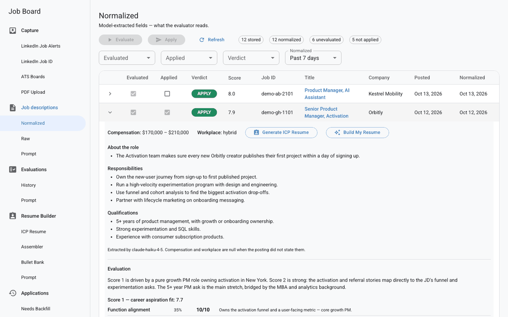
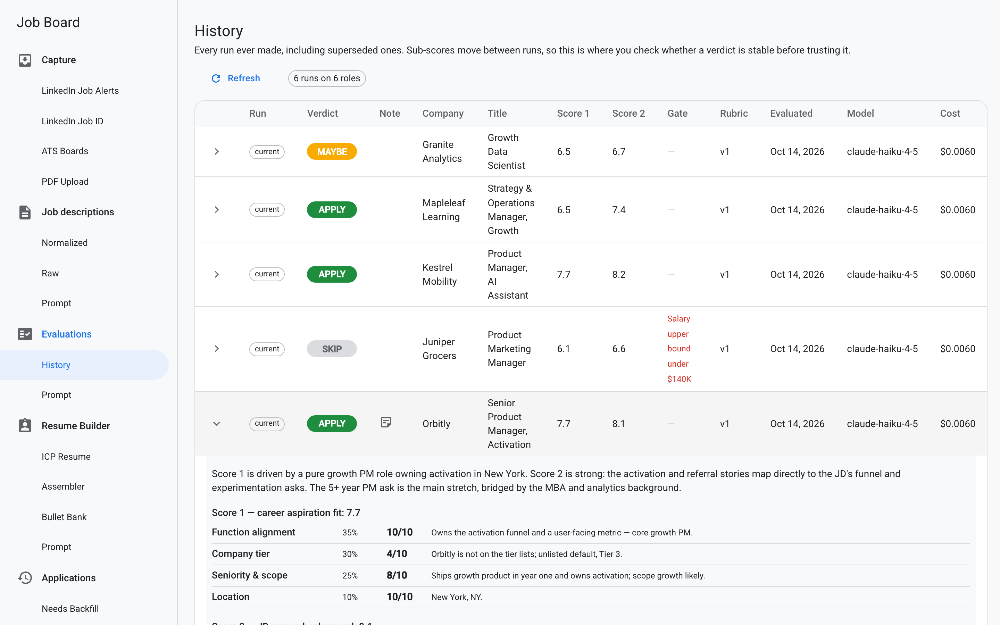
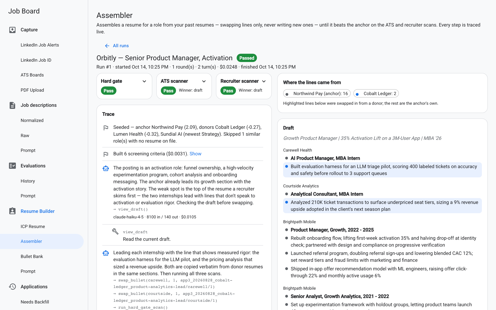
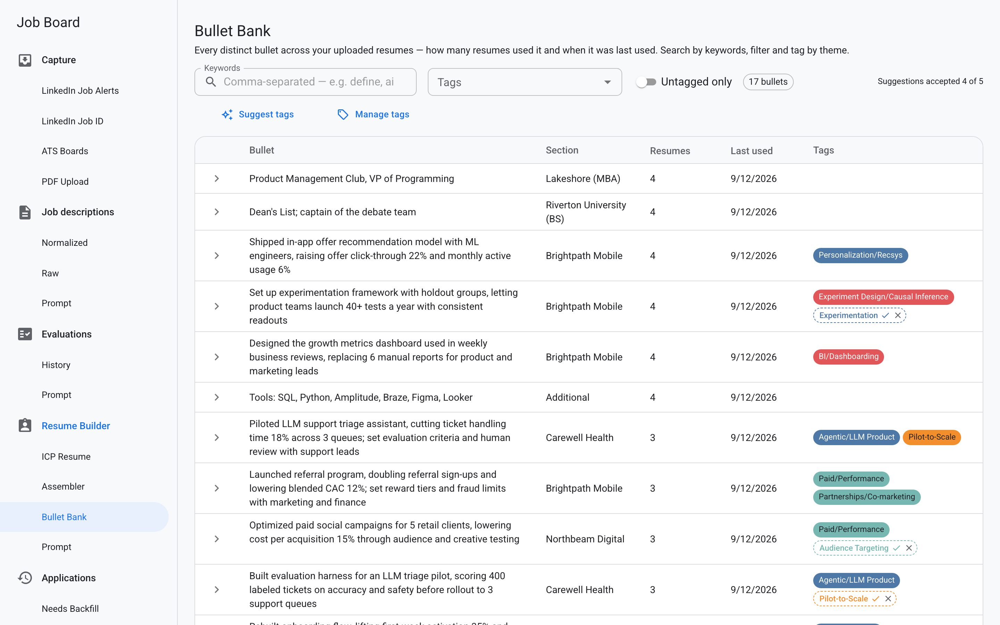
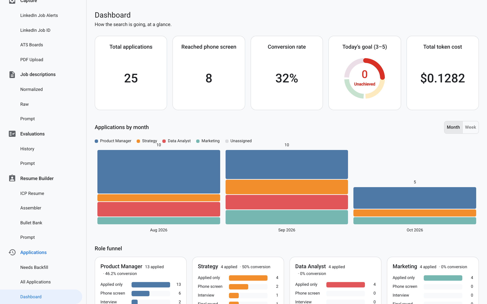
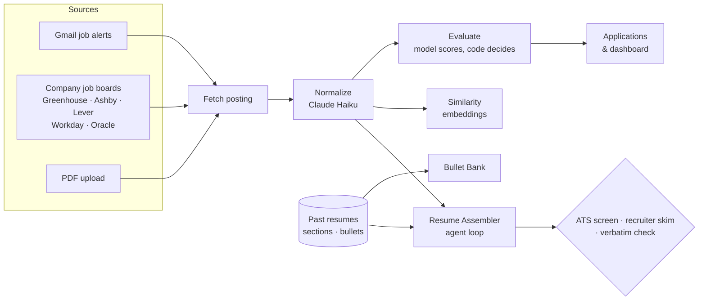

# Job Search Copilot

I built this to run my own job search like a product: a pipeline that finds
roles, reads every posting the same way, tells me which ones deserve my time,
and assembles a tailored resume from bullets I have already written and
defended — never invented ones.



*Everything shown is the demo: a fictional candidate, fictional companies,
produced by the app's own code. [Run it yourself](#try-it) in two commands.*

---

## The problem

A job search is a funnel with too many inputs and almost no feedback. Postings
arrive from email alerts and a dozen company job boards; each one takes ten
minutes to read properly; most are a poor fit; and the few good ones need a
resume that speaks to that specific posting. The expensive mistakes are the
quiet ones — skipping a great role, or sending a resume that buries the one
line a recruiter would have cared about.

## What it does

| Step | What happens |
|---|---|
| **Capture** | Reads job-alert emails (Gmail, read-only) and scans tracked company boards on Greenhouse, Ashby, Lever, Workday and Oracle, filtered to the roles and cities I target. PDFs work too. |
| **Normalize** | A model extracts responsibilities, qualifications, pay, workplace and a short "about the role" summary from each posting. |
| **Evaluate** | A rubric scores fit on ten dimensions; code applies the weights, hard gates (salary floor, years required) and the verdict: APPLY, MAYBE or SKIP. |
| **Apply & track** | Applications, outcomes and a dashboard; each posting shows the most similar past applications and how they went. |
| **Assemble a resume** | An agent swaps bullets from my past resumes into the best-matching one until it beats the original with a simulated ATS screen and a six-second recruiter skim — traced live, step by step. |
| **Bullet Bank** | Every bullet I have ever used, searchable and tagged by theme, with model-suggested tags I accept or reject. |

<table>
<tr>
<td></td>
<td></td>
</tr>
<tr>
<td align="center"><em>Every verdict shows the ten sub-scores behind it.</em></td>
<td align="center"><em>The Assembler's trace: every swap, scan and cost.</em></td>
</tr>
<tr>
<td></td>
<td></td>
</tr>
<tr>
<td align="center"><em>Bullet Bank: tags and pending suggestions.</em></td>
<td align="center"><em>Dashboard: volume, conversion, cost.</em></td>
</tr>
</table>

## Decisions worth a look

The full reasoning is in [DESIGN.md](DESIGN.md). The short version:

- **The model judges; code decides.** The evaluator only assigns sub-scores on
  fixed scales. Weights, gates and thresholds are code, so a rubric change is a
  reviewable diff, and the model never does arithmetic it can quietly get
  wrong. Uncertainty can never produce a SKIP — only a hard gate on something
  the posting actually states can — because a wrong SKIP is the one mistake
  that costs a real opportunity.
- **"Copied, not written," enforced in code.** The Assembler can only swap in
  lines that exist in a real resume, in the same section — a code check, not a
  prompt request. The same rule makes the posting summary a verbatim quote,
  verified against the source text.
- **An agent loop with a referee.** I built the Assembler's tool-use loop by
  hand: the harness validates every move, caches free re-scans, and stops on a
  pass, a round cap, a turn cap or a cost cap. Live runs surfaced two failure
  modes — replies cut off mid-thought, and an agent that never touched the
  lines the recruiter actually reads — and both were fixed by changing what
  the harness tells the agent, not by asking it nicely.
- **Measured, then optimized.** Prompt caching with a moving breakpoint cut
  the agent's cost per run by 62% on a measured run. Re-tuning the job filter
  against a 14-day dry scan of 1,438 postings took relevant roles kept from
  113 to 191 — the original keyword list was quietly 85% product-manager
  titles.
- **Knowing what a cheap judge can't tell you.** The ATS and recruiter
  screens are pairwise model judges with randomized order. I deliberately did
  not build a learning loop on top of them yet: a judge has to be calibrated
  against a human before anything optimizes against it, or the system learns
  to please the judge.
- **Everything is versioned.** Every prompt is a file with a version, stamped
  on every result it produced, and viewable in the app — so two disagreeing
  verdicts are always explainable.

## How it's built



- **Backend:** Python, FastAPI, SQLAlchemy on SQLite (one file — this is a
  single-user tool), the Anthropic API (Claude Haiku for every step except
  the ICP resume, which uses Sonnet), OpenAI embeddings for similarity.
- **Frontend:** React, TypeScript, Material UI, Vite.
- **Quality:** ~380 backend tests, every change through a reviewed pull
  request, a type check on the frontend, and live verification against real
  data before a merge.
- **Personal data stays out of the code.** Everything about the candidate —
  rubric, resume layout, salary floor — lives in a profile folder; this repo
  ships a fictional one, and a leak check guards every export.

## How I built it

Solo, over about seven weeks, with [Claude Code](https://claude.com/claude-code) as
my AI pair-programmer. I set the direction and the product decisions,
reviewed each plan before any code was written, and approved every merge —
over 80 pull requests, each one change. The agent wrote most of the code; the
judgment calls in [DESIGN.md](DESIGN.md) are mine.

## Try it

```bash
cd backend && python3 -m venv .venv && .venv/bin/pip install -r requirements.txt && cd ..
cd frontend && npm install && cd ..
backend/demo/run_demo.sh
```

Then open http://localhost:5174. The demo needs no API keys. To run it on your
own job search, see [SETUP.md](SETUP.md).
